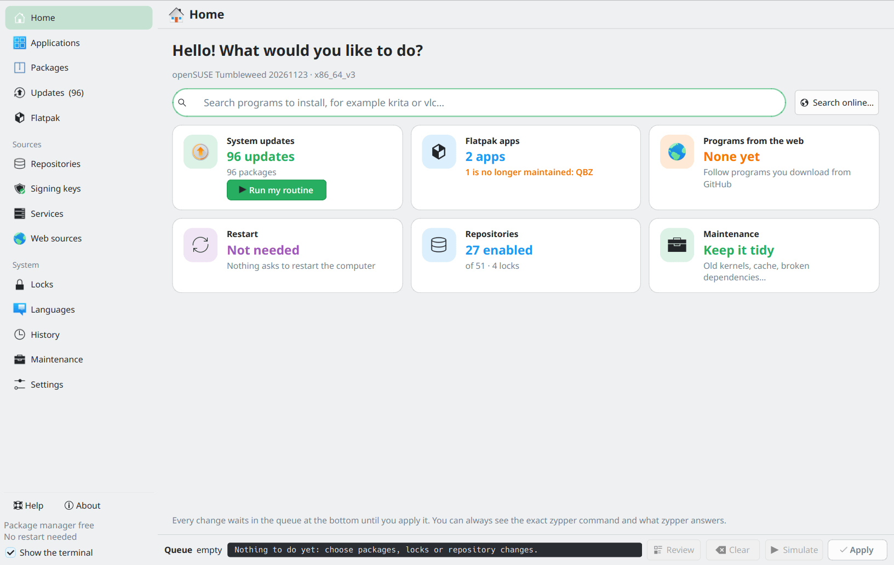
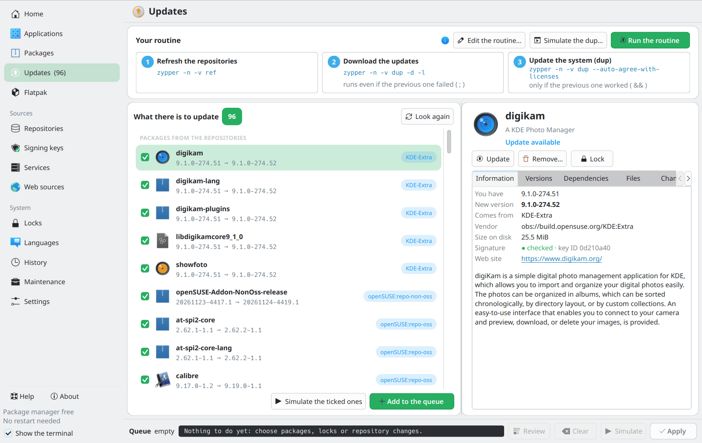
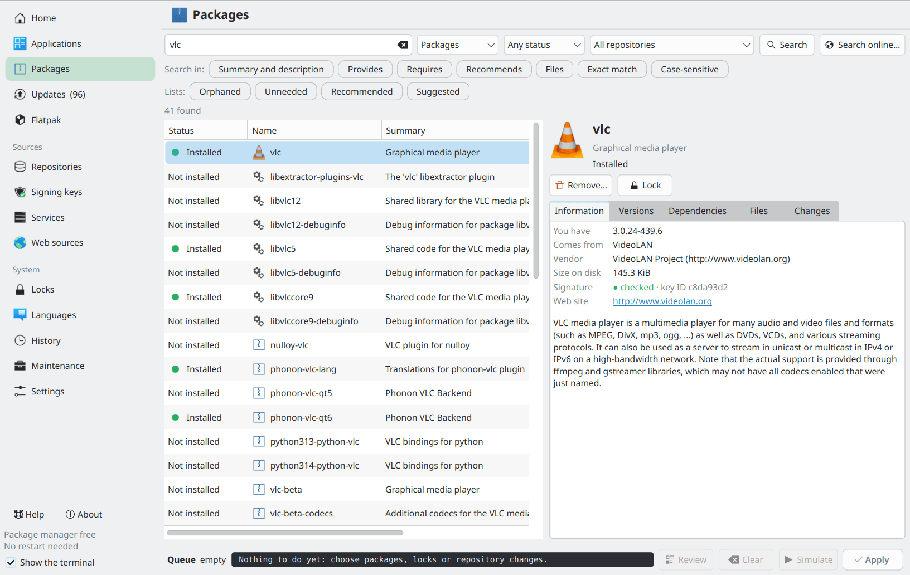

# Zypp Desk

**Every zypper feature, in a window.** Zypp Desk is a graphical front end for
[zypper](https://github.com/openSUSE/zypper), the package manager of openSUSE, for people who
want the full power of zypper without giving up a desktop application: search, install and
remove packages, upgrade the distribution, manage repositories, locks, languages, history and
maintenance — and always see the exact zypper command and its real output.

> **Status: 0.5, early development.** Searching, package details, the change queue with
> simulation and solutions to dependency problems (grouped by cause when there are many), questions
> in plain words with the exact commands underneath, routines (written or built step by step), big
> upgrades that ask whether it is worth waiting, upgrades in parts when the disk is nearly full, your
> applications by origin, discovering programs by theme, Flatpak apps, firmware updates, programs
> downloaded from the web, bridge packages for RPMs made for Fedora, repositories with a health check
> and priorities (and the ones Fedora packages leave where zypper does not look), signing keys,
> `zypp.conf`, a tray icon that tells you about updates, searching the openSUSE Build Service,
> Fedora COPR and Flathub, locks, services, languages, the history with snapper snapshots and
> maintenance work, and warnings are explained. Expect rough edges.



| Updates, with your routine and the package card | Packages |
| --- | --- |
|  |  |

## Install

Zypp Desk is built on the openSUSE Build Service for Tumbleweed:

```bash
sudo zypper addrepo --refresh https://download.opensuse.org/repositories/home:/jordirelats/openSUSE_Factory/home:jordirelats.repo
sudo zypper install zypp-desk
```

When zypper asks whether to trust the repository's signing key, compare its fingerprint with
`0FF9 D4D2 6264 C149 3957 0657 FD53 6322 2423 2811`.

The package starts a small tray icon at login for every user, which tells you when there are
updates. Each user can turn it off in Settings → Notifications; for the whole computer, add
`Hidden=true` to `/etc/xdg/autostart/io.github.jordirelats.ZyppDesk.tray.desktop` (a
configuration file: the change survives upgrades). If you had turned the icon off in an earlier
version, it stays off. After an upgrade the icon restarts itself with the new version.

The window has a **Help** section (F1) in English, Catalan, German and French.

## Ideas behind it

- **Nothing is hidden.** Every change shows the exact `zypper` command it will run, and a
  terminal panel shows zypper's own output as it happens, coloured like Konsole, with repeated
  lines folded and a filter for warnings and errors.
- **A queue of changes.** Packages, locks, repositories and languages go to a queue. The queue
  can be simulated (`--dry-run`) and then applied at once, with one password.
- **Routines.** Write your update routine the way you type it, for example
  `zypper -v ref ; zypper -v dup -d -l && zypper -v dup ; flatpak update -y`, and run it with one
  click, step by step.
- **Your applications, wherever they come from.** One list of the programs you have, from the
  repositories, from Flatpak or from files downloaded from the web, with what can be updated;
  and the openSUSE and Flathub catalogues to discover programs by theme.
- **Flatpak too.** Installed apps, search, updates and remotes, through the same queue.
- **Programs from the web.** Follow programs you install from RPM files: from GitHub releases, a
  fixed download address or a download page (a .zip with the RPM inside works too). Zypp Desk
  finds new versions, downloads them over https only, checks the SHA-256 when it is published,
  the package name and the signature, and queues them.
- **Repositories that work.** Enabled ones first, a check that tells which ones no longer answer,
  a list or a cards view, the Flatpak remotes next to them, and a search in the openSUSE Build
  Service, Fedora COPR and Flathub for what your repositories do not have — with a plain word on
  how far each source can be trusted.
- **Told when there is something new.** Without Discover nobody tells you about updates: a tray
  icon counts them (repositories, Flatpak, the web, firmware) and a notification says so once a
  day. A system timer refreshes the repositories as root; it never installs anything.
- **Undo, with snapper.** The history shows the snapshots before and after each change, compares
  their files and undoes a change.
- **Questions in plain words.** Every question that changes the system says what will be done,
  what it means for you and, underneath, the exact commands. Enter never starts a change.
- **Problems in plain words.** When a simulation finds a dependency problem, zypper's solutions
  are explained and you choose one; it goes to the queue and the queue is simulated again. Many
  problems are first grouped by cause (a repository not yet rebuilt for the new Tumbleweed,
  packages that no longer exist, locks).
- **Big upgrades and a full disk.** A big upgrade asks whether it is worth waiting, and can only
  download it or remind you tomorrow. When the disk is nearly full, the upgrade runs in parts:
  each part is a normal zypper transaction, downloaded completely before it is installed.
- **RPMs made for Fedora.** When a Fedora RPM asks for things by their Fedora names and openSUSE
  has them under other names, Zypp Desk shows the list and can write a small, empty bridge
  package; repositories that Fedora packages leave in `/etc/yum.repos.d` can be added to zypper.
- **Keys and settings.** Which signing key signs which repository and which of your packages,
  delete the ones nobody uses, import new ones after checking the fingerprint; and the settings
  of `zypp.conf`, written to a drop-in file of its own.
- **Warnings explained.** After every run, each message is shown with how serious it is, what it
  means in plain words and what to do.
- **Native.** Qt 6 through PySide6, so it follows the Plasma theme (Breeze) and the system icons.

## How it gets root

The window runs as your user. Commands that change the system go through `pkexec` and a small
helper, [`helper/zypp-desk-helper`](helper/zypp-desk-helper). It runs `zypper` with a fixed list
of subcommands and refuses options that point zypper at another root, configuration or cache
directory. Besides zypper it only does a few fixed things: snapper's list, status, undo and
rollback; importing a signing key (after checking its fingerprint again, from a clean copy) and
removing one; writing `/etc/zypp/zypp.conf.d/50-zypp-desk.conf`; and switching the
`/etc/zypp-desk/download-ahead` flag. The polkit action uses `auth_admin_keep`, so the password
is asked once and remembered for a few minutes.

## Requirements

- openSUSE (Tumbleweed is the main target) with `zypper`
- Python 3.11 or newer, `python3-pyside6` (on Tumbleweed: `python313-pyside6`), `python3-rpm`
- polkit with `pkexec`, and a polkit agent (Plasma and GNOME have one)
- `gettext-tools` to build the translations

## Running from the source tree

```bash
./install.sh      # installs the helper, the polkit action and the refresh timer (asks for the root password once)
./zypp-desk
```

Run `./install.sh` again after each update of the source folder (`git pull`): the window comes from
the folder, but the root helper and the timer are copies, and a newer window needs the helper of
its own version.

`./uninstall.sh` removes what `install.sh` installed, and says what stays (your settings, the
`zypp.conf` settings you chose). Do not mix a source install with the `zypp-desk` package:
`install.sh` stops when the package is installed, so run `./uninstall.sh` before installing it.

To open `.rpm` files with Zypp Desk when you double-click them, use the button in Settings
(nothing changes your defaults by itself).

## Building the RPM

```bash
tools/build-rpm.sh   # builds from the committed tree into build/rpmbuild/RPMS/noarch/
```

The spec file is `packaging/zypp-desk.spec`.

## Translations

Source strings are in English. Translations live in `po/`: Catalan, German and French are
complete, and so is the Help (`zypp_desk/help/`). To add a language, see
[TRANSLATING.md](TRANSLATING.md).

## License

Zypp Desk is free software: you can redistribute it and/or modify it under the terms of the
GNU General Public License as published by the Free Software Foundation, either version 3 of
the License, or (at your option) any later version. See [LICENSE](LICENSE).

Copyright © 2026 The Zypp Desk authors.

"openSUSE" and "zypper" are names of the openSUSE project. Zypp Desk is an independent project
and is not affiliated with or endorsed by openSUSE or SUSE.
